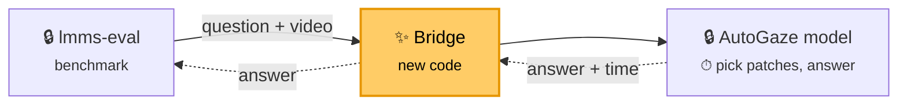

# lmms-eval bridge for AutoGaze: reproducing the codec result on EgoSchema

## The bridge

`autogaze_lmms_eval` is a bridge that lets [lmms-eval](https://github.com/EvolvingLMMs-Lab/lmms-eval), a standard independent benchmark tool, evaluate the custom models in AutoGaze without changing either codebase:



lmms-eval scores the answers (accuracy); the model's time per question gives latency. The bridge is two small programs, `client.py` (inside lmms-eval) and `server.py` (next to the model), so each side keeps its own Python environment. The launcher runs one bridge + model per method (dense, autogaze, codec), each on its own GPU.

We use it to reproduce the EgoSchema "Headline result" of `AutoGaze/Codec_Selector_Feasibility.md`, where NVILA-8B-HD-Video reads **all** image patches (dense), patches picked by a small network (autogaze), or patches picked from HEVC compression data (codec). Step 8 runs Qwen3.5-9B and Nemotron-3-Nano-Omni-30B-A3B on the same 500 questions on H100, one Slurm job per model, set up like `AutoGaze/RESULTS_LATENCY_ACCURACY.md`.

## Expected result

| 500 questions, 1 GB200/method | Accuracy (±2) | Tokens (exact) | Sec/question (varies) |
|---|--:|--:|--:|
| codec | 65.4% | 2,783 | 1.44 |
| dense | 64.0% | 24,690 | 3.54 |
| autogaze | 65.8% | 1,837 | 7.33 |

## Optional: let an AI agent run it

Skip this section to run everything by hand.

Do the setup yourself (steps 1–5 for NVILA; for step 8 the envs, weights and native build listed there must already exist), because installs, builds and writes to `$HF_HOME` are off-limits to the agent. Then hand the runs to an agent such as Claude Code. Three guardrails keep it from changing anything that would invalidate the result:

**1. Folder permissions.** Make the inputs read-only at the OS level:

```bash
chmod -R a-w AutoGaze lmms-eval autogaze_lmms_eval tools envs reference LMMS_EVAL_BRIDGE.md
```

| Folder | Agent may |
|---|---|
| `AutoGaze/`, `lmms-eval/`, `autogaze_lmms_eval/`, `tools/` | read and run scripts; never edit, rebuild, `pip install` or change git state |
| `$HF_HOME`, `$CONDA_BASE` | read only; only the launcher's download writes data |
| `runs/` | read only, enforced by the sandbox; only `run_eval.sbatch`, the launcher and `verify_alignment.sh` (with lmms-eval, the bridge and the summary scripts they start) write there, each into a new folder that is made read-only at the end |
| `.claude/` | nothing: these are the agent's own rules |

**2. Claude Code settings.** Install the rules from `repro/claude_settings.local.json` with your paths:

```bash
mkdir -p .claude
sed -e "s#/home/scratch.thannan_wwfo/codec_reproduce#$WORK#g" -e "s#/home/thannan/scratch/codec_reproduce#$WORK#g" \
    -e "s#/home/scratch.thannan_wwfo/hf_cache#$HF_HOME#g"     -e "s#/home/thannan/scratch/hf_cache#$HF_HOME#g" \
    -e "s#/home/scratch.thannan_wwfo/miniforge-aarch64#$CONDA_BASE#g" -e "s#/home/thannan/scratch/miniforge-aarch64#$CONDA_BASE#g" \
    autogaze_lmms_eval/repro/claude_settings.local.json > .claude/settings.local.json
```

It has three layers:
- `permissions.deny` blocks the agent's file-edit tool on those folders and its reads of result files (`RESULTS.md`, `SUMMARY.md`, lmms-eval results and samples, timing logs).
- The sandbox is on and strict (`enabled`, `failIfUnavailable`, `allowUnsandboxedCommands: false`), and `sandbox.filesystem.denyWrite` covers the code, the docs, `.claude/`, `runs/`, `$HF_HOME` and the conda installs. Every shell command the agent runs, and everything it starts, therefore can't write there.
- `sandbox.excludedCommands` lets exactly these run outside the sandbox: `sbatch <abs path>/scripts/run_eval.sbatch …`, the launcher and `tools/verify_alignment.sh` called by their absolute paths, and `squeue`/`sacct`. They're the only writers. They take a plain tag, write only into a new `runs/<tag>/`, load code only from the read-only trees, and lock their output.

`autoMode.hard_deny` repeats these rules in plain English so auto mode never approves a way around them.

**3. Sandbox.** Start the agent from `$WORK`, passing the same rules again with `--settings`, with `HF_TOKEN` exported:

```bash
cd $WORK && claude --settings $WORK/.claude/settings.local.json
```

The rules turn the sandbox on, and Claude Code refuses to start without it. You need `--settings` if your organization's managed settings make the sandbox admin-required (for example `allowManagedDomainsOnly`). In that case Claude Code ignores a project's `excludedCommands`, so without the flag the agent can't reach Slurm. Check it by asking the new session to run `squeue -u $USER`. Then give it `autogaze_lmms_eval/repro/RUN_SESSION_PROMPT.md` as the task. It submits the two H100 jobs of step 8, watches them, resubmits once on a transient failure and otherwise stops and reports. It never prints `HF_TOKEN` and never reads or reports results: it gives back only tags, job ids, commands, exit codes, `preflight.txt` and the paths of the `SUMMARY.md` files the jobs wrote.

## You need

- NVILA (steps 1–7): GB200 (`aarch64`) Slurm node, 4 GPUs, ~250 GB disk; ~1 h setup + ~1 h run
- Qwen3.5 / Omni (step 8): access to the H100 partition `H100_80G_HBM3_SXM_AMD_preprod`, plus the x86_64 `nemo-omni` and `lmms-eval-bridge` envs, the `model_compat` native build and weights it lists (all already in place on Thannan's scratch); ~1 h per model including queue
- SSH access to GitHub `thannan-ctrl/{AutoGaze,autogaze_lmms_eval}` and GitLab `gitlab-master.nvidia.com:12051/seadie/hevc_dump`
- Hugging Face token that accepted the `lmms-lab/egoschema` terms
- The kit `/home/scratch.thannan_wwfo/codec_reproduce/{tools,envs,reference}` 

## 1. Node and variables

```bash
srun --partition=<gb200 partition> --gres=gpu:4 --time=04:00:00 --pty bash
tmux
```

Paste in **every** new shell (unset variables silently fall back to Thannan's paths):

```bash
export WORK=/path/to/your/codec_reproduce CONDA_BASE=/path/to/your/miniforge-aarch64
export HF_HOME=$WORK/hf_cache SERVER_ENV=autogaze_av19 CLIENT_ENV=lmms-eval HF_TOKEN=hf_...
unset PYTHONPATH; mkdir -p $WORK && cd $WORK
[ -x $CONDA_BASE/bin/conda ] && eval "$($CONDA_BASE/bin/conda shell.bash hook)"
L=$WORK/autogaze_lmms_eval/scripts/run_egoschema_headline.sh   # launcher
T=$WORK/autogaze_lmms_eval/scripts/headline_table.py            # results table
W=$HF_HOME/egoschema/videos/001934bb-81bd-4cd8-a574-0472ef3f6678.mp4   # warm-up video
QWEN=$HF_HOME/hub/models--Qwen--Qwen3.5-9B/snapshots/c202236235762e1c871ad0ccb60c8ee5ba337b9a   # step 8 only
OMNI=$HF_HOME/hub/models--nvidia--Nemotron-3-Nano-Omni-30B-A3B-Reasoning-BF16/snapshots/e5e9932441de940c9a62185c870ea5bcd4cd24e2
uname -m   # must be aarch64
```

## 2. Conda and code

```bash
# conda (skip if $CONDA_BASE already exists)
curl -L -o /tmp/mf.sh https://github.com/conda-forge/miniforge/releases/latest/download/Miniforge3-Linux-aarch64.sh
bash /tmp/mf.sh -b -p $CONDA_BASE && eval "$($CONDA_BASE/bin/conda shell.bash hook)"

# code at the exact commits used
git clone git@github.com:thannan-ctrl/AutoGaze.git && git -C AutoGaze checkout 9899fd6829444fdd5ebc86366fd35073816ac635
git clone git@github.com:thannan-ctrl/autogaze_lmms_eval.git && git -C autogaze_lmms_eval checkout cc8a3d182a5368acdb600da18cb6327436276894
git clone https://github.com/EvolvingLMMs-Lab/lmms-eval.git && git -C lmms-eval checkout d6cc2b567db7aeacbbf1af11b6595676e784d1d3
cp -r /home/scratch.thannan_wwfo/codec_reproduce/{tools,envs,reference,LMMS_EVAL_BRIDGE.md} . && chmod -R u+w tools
```

Keep all folders side by side in `$WORK`; results go to `$WORK/runs/`.

AutoGaze `9899fd6` (branch `pareto/main`) adds `model_compat/` for step 8. Outside `model_compat/` it differs from the earlier pin `0234e8e` only in docs and figures, so steps 1–7 are unchanged.

## 3. Python environments

```bash
# server (model); needs av 19 — av 18 crashes every few hundred videos
conda create -y -n autogaze_av19 -c conda-forge python=3.12.13 && conda activate autogaze_av19
pip install -r envs/server_requirements.txt
python -c "import av, torch, transformers as t; print(av.__version__, torch.__version__, torch.cuda.is_available(), t.__version__)"
#   expect: 19.0.1 2.14.1 True 5.14.1
conda deactivate

# client (lmms-eval + bridge)
conda create -y -n lmms-eval -c conda-forge python=3.11.15 decord=0.6.0 && conda activate lmms-eval
pip install -r envs/client_requirements.txt
pip install --no-deps -e lmms-eval -e autogaze_lmms_eval
python -c "from lmms_eval.models import get_model; print(get_model('autogaze'))"
#   expect: <class 'autogaze_lmms_eval.client.AutoGaze'>
conda deactivate

# step 8 only: server for Qwen3.5 / Nemotron-Omni = the autogaze_av19 packages plus their kernels
# (a separate env, so the NVILA env above stays exactly as pinned). The two kernel packages compile
# against torch 2.14.1 for aarch64 and need nvcc on PATH (~20 min).
conda create -y -n autogaze_mc -c conda-forge python=3.12.13 && conda activate autogaze_mc
pip install -r envs/server_requirements.txt
pip install flash-linear-attention==0.5.2 fla-core==0.5.2 timm==1.0.22 einops==0.8.2 open_clip_torch==3.3.0 \
            decord==0.6.0 librosa==0.11.0 soundfile==0.13.1 scipy==1.15.3
pip install --no-build-isolation causal-conv1d==1.6.0 mamba-ssm==2.3.2.post1
python -c "from transformers.models.qwen3_5 import modeling_qwen3_5 as m; import mamba_ssm; print(m.is_fast_path_available)"
#   expect: True
conda deactivate
```

## 4. Codec tools

```bash
$CONDA_BASE/envs/autogaze_av19/bin/python -m venv .buildtools && .buildtools/bin/pip install cmake==4.4.2
PATH=$WORK/.buildtools/bin:$PATH tools/build_autogaze_native.sh
#   expect: [native] native tools ready in .../AutoGaze/native/build_aarch64
```

## 5. Model and videos

```bash
# check Hugging Face still serves the pinned versions (all must print OK)
conda activate lmms-eval
python - <<'EOF'
from huggingface_hub import HfApi
a = HfApi()
for repo, sha in [("nvidia/NVILA-8B-HD-Video", "7a5670e20da435d98b0efdc49f9a536f73985152"),
                  ("nvidia/AutoGaze", "5100fae739ec1bf3f875914fa1b703846a18943a"),
                  ("lmms-lab/egoschema", "58350524ea7eb29c47000121f4f4b65eb6b4acb9"),
                  # step 8 only
                  ("Qwen/Qwen3.5-9B", "c202236235762e1c871ad0ccb60c8ee5ba337b9a"),
                  ("nvidia/Nemotron-3-Nano-Omni-30B-A3B-Reasoning-BF16", "e5e9932441de940c9a62185c870ea5bcd4cd24e2"),
                  ("nvidia/C-RADIOv4-H", "0057b339059c0b9e1b4ba996f975410ebbfdfcc8")]:
    got = (a.dataset_info if "egoschema" in repo else a.model_info)(repo).sha
    print(repo, "OK" if got == sha else f"CHANGED to {got}: tell Thannan")
EOF
conda deactivate; conda activate autogaze_av19
hf download nvidia/NVILA-8B-HD-Video --revision 7a5670e20da435d98b0efdc49f9a536f73985152
hf download nvidia/AutoGaze --revision 5100fae739ec1bf3f875914fa1b703846a18943a
# step 8 only (~85 GB). C-RADIOv4-H is the Omni vision tower's remote code, which transformers
# looks up at its main revision, so it is downloaded without --revision (the check above pins it).
hf download Qwen/Qwen3.5-9B --revision c202236235762e1c871ad0ccb60c8ee5ba337b9a
hf download nvidia/Nemotron-3-Nano-Omni-30B-A3B-Reasoning-BF16 --revision e5e9932441de940c9a62185c870ea5bcd4cd24e2
hf download nvidia/C-RADIOv4-H
conda deactivate

# videos (~200 GB); if interrupted: rm -rf $HF_HOME/egoschema and re-run with a new name
$L --download-only egoschema_download
ls $HF_HOME/egoschema/videos | wc -l   # expect 5032
```

## 6. Test

```bash
tools/verify_alignment.sh dense autogaze codec       # expect PASS for each
R=egoschema_smoke_$(date +%Y%m%d_%H%M)
$L --limit 8 --modes "dense autogaze codec" --warmup-video $W $R   # ~10 min
cat runs/$R/RESULTS.md                              # written by the launcher
python reference/compare_tokens.py runs/$R reference
#   expect 0 mismatches; mean tokens 25,927 / 1,980 / 2,903 (dense / autogaze / codec)
```

## 7. Full run and results

```bash
R=egoschema_headline_$(date +%Y%m%d)    # every run needs a new name
$L --modes "dense autogaze codec" --warmup-video $W $R   # ~1 h; logs in runs/$R/logs/
cat runs/$R/RESULTS.md                                   # accuracy + timing, compare with Expected result
python reference/compare_tokens.py runs/$R reference     # expect 500 questions, 0 mismatches
```

Always pass `--modes`: the default adds `codec_nvdec`, which needs a newer driver.

**What every run writes.** At the end the launcher runs `headline_table.py` itself and writes `runs/$R/RESULTS.md`. That file has accuracy, the latency breakdown (preproc, selector, ViT, LLM, E2E) and an **end-to-end cross-check**. It also writes `SHA256SUMS` and makes `runs/$R/` read-only. The terminal shows only pass/fail `[status]` lines.

The cross-check compares three measurements of each question's latency:
- the repo's own `e2e_ms` (AutoGaze or model_compat timers);
- the bridge server's clock around each answer (`bridge_server_ms` in `timing_<mode>.jsonl`);
- the lmms-eval client's clock around each HTTP request (`client_timing_<mode>.jsonl`).

`Check` reads `ok` when the bridge clock agrees with the reported E2E within max(5%, 50 ms) on average, after taking out steps the repo leaves out of its timer on purpose (step 8). Otherwise it shows how much more the bridge measured, which is time the repo's timer leaves out. `python $T runs/$R <modes>` prints the same table again.

## 8. Qwen3.5-9B and Nemotron-3-Nano-Omni on H100

`scripts/run_eval.sbatch` runs one model on lmms-eval's `egoschema_subset` (the same 500 questions as above) as one Slurm job on one 80 GB H100. It serves the model through AutoGaze's `model_compat` adapters, the code behind `AutoGaze/RESULTS_LATENCY_ACCURACY.md`. These adapters are read from the `AutoGaze` checkout (commit `9899fd6`) and never edited.

**What a job does.** Everything is fixed inside the script; the only inputs are `--model`, `--dataset egoschema`, an optional `--smoke-only`, and a new tag.
1. **Preflight**, written to `runs/<tag>/preflight.txt`. It stops the job before any GPU work if a check fails:
   - x86_64 node with an 80 GB H100;
   - `HF_TOKEN` set;
   - AutoGaze at `9899fd6` and lmms-eval at `d6cc2b5`, with no code changes (`.claude/` and `.vscode/` are ignored);
   - native `dump_cu`, weights and the EgoSchema videos present;
   - both envs import their kernels and see CUDA;
   - the warm-up video is not one of the 500.
2. **Smoke**: 8 questions per arm, then a gate. Every arm must read `timing ok, client log ok, e2e cross-check ok, replies ok`, or the job stops.
3. **Full**: 500 questions per arm.
4. `scripts/summarize_suite.py` writes `runs/<tag>/SUMMARY.md`, then `SHA256SUMS`, and the whole `runs/<tag>/` is made read-only.

The arms run one after another in the same job on the same GPU, as in the reference, so dense and hybrid are compared on the same host. The partition's nodes have one GPU each, so the two models' jobs run in parallel on different nodes.

| Model | `--model` | Frames | Arms | Weights |
|---|---|--:|---|---|
| Qwen3.5-9B | `qwen3_5` | 128 | `dense`, `codec_mv_hybrid` | HF snapshot `c2022362…` in `$HF_HOME` |
| Nemotron-3-Nano-Omni-30B-A3B | `nemotron_omni` | 64 (675 patches, EgoSchema's native 480×360) | `dense`, `codec_mv_hybrid` | `model_compat/weights/Nemotron-3-Nano-Omni-30B-A3B-Reasoning-BF16`, the reference's copy |

`codec_mv_hybrid` is the reference's recommended strict-L1 point, `codec@first=1.0@chunk=16@rest=0.25`:
- the H.264 motion-vector selector chooses the patches, with no re-encode;
- the first frame pair of every 16 frames keeps all patches;
- the rest keep the top 25%.

The other `mc_backend.py` modes (`codec_mv`, `codec_mv_keep`) still work through the launcher, but the job doesn't run them.

**Setup it uses** (the reference's own, so nothing is installed):
- server env `$CONDA_BASE/envs/nemo-omni` (x86_64; torch 2.12.0+cu132, transformers 5.5.0, av 17.0.1);
- Qwen kernels from `model_compat/pylibs/fla` (vendored `fla` 0.5.2), plus `causal_conv1d` in the env;
- client env `lmms-eval-bridge`, an editable install of this repo's `lmms-eval/` and `autogaze_lmms_eval/`;
- native selector build `model_compat/native_build_x86_64`;
- Slurm partition `H100_80G_HBM3_SXM_AMD_preprod`, `--gres=gpu:H100:1,gpu_memory:80G` (one node of that partition has a 64 GB GPU), 4 h limit;
- every `MC_*` and `PYTHON*` variable from the caller's environment is cleared, and the pareto "best" settings are applied (`mc_backend.py`).

**Run**, from a login node that can submit to that partition:

```bash
mkdir -p $WORK/runs/_slurm   # once; Slurm writes run_eval_<jobid>.log here
D=$(date +%Y%m%d_%H%M)
sbatch $WORK/autogaze_lmms_eval/scripts/run_eval.sbatch --model qwen3_5 --dataset egoschema qwen3_5_egoschema_$D
sbatch $WORK/autogaze_lmms_eval/scripts/run_eval.sbatch --model nemotron_omni --dataset egoschema nemotron_omni_egoschema_$D
```

Add `--smoke-only` to stop after the gate (about 10 min). Smoke jobs 2730776 (Qwen) and 2730927 (Omni) passed every check. Each full job loads its model four times (smoke and full, two arms each):

| | Qwen3.5 | Omni |
|---|---|---|
| model load | ~2.5 min | ~5.5 min first time, ~1.5 min after |
| full job | ~40 min | ~35 min |

Queue time is extra. The job exits 0 only if every step passed; a failed full-run arm still gets a `SUMMARY.md` but the job exits 1.

**Hand it to an agent.** The agent submits both jobs, watches them and reports back. It can't change code, envs, data or results, and it can't read the result files. Its rules are the three guardrails at the top ("Optional: let an AI agent run it").
1. **Once:** install the rules (guardrail 2) and create `runs/_slurm/` (the `mkdir` above).
2. **Start the session** in a terminal on a login node that can submit to the H100 partition. Use your own token; the agent never prints it:
   ```bash
   export HF_TOKEN=hf_...
   cd $WORK && claude --settings $WORK/.claude/settings.local.json
   ```
   `--settings` is what lets the agent reach Slurm (guardrail 3).
3. **Check the session**: ask it to run `squeue -u $USER`. It should print your queue. If it fails with `Invalid user` or `Unable to contact slurm controller`, the session started without `--settings`; restart it with the flag.
4. **Give it the task**:
   ```text
   follow $WORK/RUN_SESSION_PROMPT.md
   ```
   (`autogaze_lmms_eval/repro/RUN_SESSION_PROMPT.md` is the same file). It then:
   - submits one `sbatch …/run_eval.sbatch --model … --dataset egoschema <tag>` per model, with new dated tags;
   - watches with `squeue`/`sacct` and the logs, no more often than every 5 minutes;
   - resubmits a job once under a new tag if the failure looks transient (node failure, timeout, out of memory at load);
   - for anything else, it stops and tells you what failed. It never tries a fix.
5. **Its report** has, per job: tag, job id, the exact `sbatch` command, final state and exit code, `preflight.txt`, the path of `SUMMARY.md`, and the log lines of anything that failed. It contains no result numbers.
6. **Read `runs/<tag>/SUMMARY.md` yourself.** It's read-only, like everything the job wrote.

The first agent run (jobs 2731219 and 2731222) followed exactly this.

**Where things are.**

| Path | What |
|---|---|
| `runs/_slurm/run_eval_<jobid>.log` | job log: preflight, one `[run_eval]` line per step, `[status]` lines, no result numbers |
| `runs/<tag>/preflight.txt` | every preflight check and the env versions |
| `runs/<tag>/{smoke,full}/<arm>/` | one launcher run per arm: `run_info.txt`, `RESULTS.md`, lmms-eval output `lmms_<arm>/`, `timing_<arm>.jsonl`, `client_timing_<arm>.jsonl`, `logs/`, `SHA256SUMS` |
| `runs/<tag>/SUMMARY.md` | both stages: accuracy, tokens, latency breakdown, e2e cross-check, unparsed replies, and the reference values |

**Reference values** (`AutoGaze/RESULTS_LATENCY_ACCURACY.md`, H100 SXM, same 500 questions):

| Model | Arm | Accuracy | Sec/question | Visual tokens |
|---|---|--:|--:|--:|
| Qwen3.5, 128f | dense | 72.8% | 1.14 | 11,225 |
| Qwen3.5, 128f | codec_mv_hybrid | 69.4% | 0.81 | 3,847 |
| Omni, 64f | dense | 64.0% | 0.66 | 5,216 |
| Omni, 64f | codec_mv_hybrid | 59.8% | 0.52 | 1,786 |

One standard error is about 2 points. Expect differences, because lmms-eval is the judge here:
- **Prompt:** lmms-eval's EgoSchema prompt instead of model_compat's "Question: … Answer with the letter of the correct option only."
- **Answer length:** up to 16 new tokens instead of 8.
- **Parser:** lmms-eval's. It picks a random letter when a reply has none, where model_compat counted those as wrong. `SUMMARY.md` counts such replies per arm under "No letter".
- **Latency:** the reference timed all arms in one process, and this run starts a fresh server per arm.

`SUMMARY.md` shows the reference next to each arm for information only; there is no pass/fail on accuracy or latency.

**E2E cross-check for these models.** model_compat leaves two steps out of its `e2e_ms` on purpose, as its own runner does: reading the video into the page cache before each question, and clearing the per-question codec cache after it. The bridge times both (`preread_ms`, `cleanup_ms`) and takes only those out of the bridge-clock gap, shown as *Untimed by design* in the cross-check table. Any other gap still fails the check.

**GB200 (untested).** The launcher still accepts `--model qwen3_5|nemotron_omni` with `SERVER_ENV=autogaze_mc` (step 3), for example:

```bash
$L --model qwen3_5 --model-path $QWEN --nvf 128 --modes "dense codec_mv_hybrid" --warmup-video $W <tag>
```

No GB200 run of these models has got past server startup, so treat the H100 job as the supported path. The earlier attempts set `MC_PYTHONPATH` to the env's own site-packages, which breaks `import torch`; don't set it.

**More:** `AutoGaze/Codec_Selector_Feasibility.md` (original study), `autogaze_lmms_eval/EGOSCHEMA_HEADLINE.md` (launcher options), `LMMS_EVAL_BRIDGE.md` (bridge internals).
