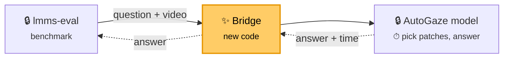

# lmms-eval bridge for AutoGaze: reproducing the codec result on EgoSchema

## The bridge

`autogaze_lmms_eval` is a bridge that lets [lmms-eval](https://github.com/EvolvingLMMs-Lab/lmms-eval), a standard independent benchmark tool, evaluate the custom models in AutoGaze without changing either codebase:



lmms-eval scores the answers (accuracy); the model's time per question gives latency. The bridge is two small programs, `client.py` (inside lmms-eval) and `server.py` (next to the model), so each side keeps its own Python environment. The launcher runs one bridge + model per method (dense, autogaze, codec), each on its own GPU.

We use it to reproduce the EgoSchema "Headline result" of `AutoGaze/Codec_Selector_Feasibility.md`, where NVILA-8B-HD-Video reads **all** image patches (dense), patches picked by a small network (autogaze), or patches picked from HEVC compression data (codec). Step 8 runs Qwen3.5-9B and Nemotron-3-Nano-Omni-30B-A3B on the same 500 questions on H100, one Slurm job per model, set up like `AutoGaze/RESULTS_LATENCY_ACCURACY.md`.

## Expected result

| 500 questions, 1 GB200/method | Accuracy (±2) | Tokens (exact) | Sec/question (varies) |
|---|--:|--:|--:|
| codec | 65.4% | 2,783 | 1.44 |
| dense | 64.0% | 24,690 | 3.54 |
| autogaze | 65.8% | 1,837 | 7.33 |

## Optional: let an AI agent run it

Skip this section to run everything by hand.

Do the setup yourself (steps 1–5 for NVILA; for step 8 the envs, weights and native build listed there must already exist), because installs, builds and writes to `$HF_HOME` are off-limits to the agent. Then hand the runs to an agent such as Claude Code. Three guardrails keep it from changing anything that would invalidate the result:

**1. Folder permissions.** Make the inputs read-only at the OS level:

```bash
chmod -R a-w AutoGaze lmms-eval autogaze_lmms_eval tools envs reference LMMS_EVAL_BRIDGE.md
```

| Folder | Agent may |
|---|---|
| `AutoGaze/`, `lmms-eval/`, `autogaze_lmms_eval/`, `tools/` | read and run scripts; never edit, rebuild, `pip install` or change git state |
| `$HF_HOME`, `$CONDA_BASE` | read only; only the launcher's download writes data |
| `runs/` | read only, enforced by the sandbox; only `run_eval.sbatch`, the launcher and `verify_alignment.sh` (with lmms-eval, the bridge and the summary scripts they start) write there, each into a new folder that is made read-only at the end |
| `.claude/` | nothing: these are the agent's own rules |

**2. Claude Code settings.** Install the rules from `repro/claude_settings.local.json` with your paths:

```bash
mkdir -p .claude
sed -e "s#/home/scratch.thannan_wwfo/codec_reproduce#$WORK#g" -e "s#/home/thannan/scratch/codec_reproduce#$WORK#g" \
    -e "s#/home/scratch.thannan_wwfo/hf_cache#$HF_HOME#g"     -e "s#/home/thannan/scratch/hf_cache#$HF_HOME#g" \
    -e "s#/home/scratch.thannan_wwfo/miniforge-aarch64#$CONDA_BASE#g" -e "s#/home/thannan/scratch/miniforge-aarch64#$CONDA_BASE#g" \
    autogaze_lmms_eval/repro/claude_settings.local.json > .claude/settings.local.json
```

It has three layers:
- `permissions.deny` blocks the agent's file-edit tool on those folders and its reads of result files (`RESULTS.md`, `SUMMARY.md`, lmms-eval results and samples, timing logs).
- The sandbox is on and strict (`enabled`, `failIfUnavailable`, `allowUnsandboxedCommands: false`), and `sandbox.filesystem.denyWrite` covers the code, the docs, `.claude/`, `runs/`, `$HF_HOME` and the conda installs. Every shell command the agent runs, and everything it starts, therefore can't write there.
- `sandbox.excludedCommands` lets exactly these run outside the sandbox: `sbatch <abs path>/scripts/run_eval.sbatch …`, the launcher and `tools/verify_alignment.sh` called by their absolute paths, and `squeue`/`sacct`. They're the only writers. They take a plain tag, write only into a new `runs/<tag>/`, load code only from the read-only trees, and lock their output.

`autoMode.hard_deny` repeats these rules in plain English so auto mode never approves a way around them.

**3. Sandbox.** Start the agent from `$WORK`, passing the same rules again with `--settings`, with `HF_TOKEN` exported:

```bash
cd $WORK && claude --settings $WORK/.claude/settings.local.json
```

The rules turn the sandbox on, and Claude Code refuses to start without it. You need `--settings` if your organization's managed settings make the sandbox admin-required (for example `allowManagedDomainsOnly`). In that case Claude Code ignores a project's `excludedCommands`, so without the flag the agent can't reach Slurm. Check it by asking the new session to run `squeue -u $USER`. Then give it `autogaze_lmms_eval/repro/RUN_SESSION_PROMPT.md` as the task. It submits the two H100 jobs of step 8, watches them, resubmits once on a transient failure and otherwise stops and reports. It never prints `HF_TOKEN` and never reads or reports results: it gives back only tags, job ids, commands, exit codes, `preflight.txt` and the paths of the `SUMMARY.md` files the jobs wrote.

## You need

- NVILA (steps 1–7): GB200 (`aarch64`) Slurm node, 4 GPUs, ~250 GB disk; ~1 h setup + ~1 h run
- Qwen3.5 / Omni (step 8): access to the H100 partition `H100_80G_HBM3_SXM_AMD_preprod`, plus the x86_64 `nemo-omni` and `lmms-eval-bridge` envs, the `model_compat` native build and weights it lists (all already in place on Thannan's scratch); ~1 h per model including queue
- SSH access to GitHub `thannan-ctrl/{AutoGaze,autogaze_lmms_eval}` and GitLab `gitlab-master.nvidia.com:12051/seadie/hevc_dump`
- Hugging Face token that accepted the `lmms-lab/egoschema` terms
- The kit `/home/scratch.thannan_wwfo/codec_reproduce/{tools,envs,reference}` 

## 1. Node and variables

```bash
srun --partition=<gb200 partition> --gres=gpu:4 --time=04:00:00 --pty bash
tmux
```

Paste in **every** new shell (unset variables silently fall back to Thannan's paths):

```bash
export WORK=/path/to/your/codec_reproduce CONDA_BASE=/path/to/your/miniforge-aarch64
export HF_HOME=$WORK/hf_cache SERVER_ENV=autogaze_av19 CLIENT_ENV=lmms-eval HF_TOKEN=hf_...
unset PYTHONPATH; mkdir -p $WORK && cd $WORK
[ -x $CONDA_BASE/bin/conda ] && eval "$($CONDA_BASE/bin/conda shell.bash hook)"
L=$WORK/autogaze_lmms_eval/scripts/run_egoschema_headline.sh   # launcher
T=$WORK/autogaze_lmms_eval/scripts/headline_table.py            # results table
W=$HF_HOME/egoschema/videos/001934bb-81bd-4cd8-a574-0472ef3f6678.mp4   # warm-up video
QWEN=$HF_HOME/hub/models--Qwen--Qwen3.5-9B/snapshots/c202236235762e1c871ad0ccb60c8ee5ba337b9a   # step 8 only
OMNI=$HF_HOME/hub/models--nvidia--Nemotron-3-Nano-Omni-30B-A3B-Reasoning-BF16/snapshots/e5e9932441de940c9a62185c870ea5bcd4cd24e2
uname -m   # must be aarch64
```

## 2. Conda and code

```bash
# conda (skip if $CONDA_BASE already exists)
curl -L -o /tmp/mf.sh https://github.com/conda-forge/miniforge/releases/latest/download/Miniforge3-Linux-aarch64.sh
bash /tmp/mf.sh -b -p $CONDA_BASE && eval "$($CONDA_BASE/bin/conda shell.bash hook)"

# code at the exact commits used
git clone git@github.com:thannan-ctrl/AutoGaze.git && git -C AutoGaze checkout 9899fd6829444fdd5ebc86366fd35073816ac635
git clone git@github.com:thannan-ctrl/autogaze_lmms_eval.git && git -C autogaze_lmms_eval checkout 6de3632ee2c38fce6824766cd9c635da6fd83e23
git clone https://github.com/EvolvingLMMs-Lab/lmms-eval.git && git -C lmms-eval checkout d6cc2b567db7aeacbbf1af11b6595676e784d1d3
cp -r /home/scratch.thannan_wwfo/codec_reproduce/{tools,envs,reference,LMMS_EVAL_BRIDGE.md} . && chmod -R u+w tools
```

Keep all folders side by side in `$WORK`; results go to `$WORK/runs/`.

AutoGaze `9899fd6` (branch `pareto/main`) adds `model_compat/` for step 8. Outside `model_compat/` it differs from the earlier pin `0234e8e` only in docs and figures, so steps 1–7 are unchanged.

## 3. Python environments

```bash
# server (model); needs av 19 — av 18 crashes every few hundred videos
conda create -y -n autogaze_av19 -c conda-forge python=3.12.13 && conda activate autogaze_av19
pip install -r envs/server_requirements.txt
python -c "import av, torch, transformers as t; print(av.__version__, torch.__version__, torch.cuda.is_available(), t.__version__)"
#   expect: 19.0.1 2.14.1 True 5.14.1
conda deactivate

# client (lmms-eval + bridge)
conda create -y -n lmms-eval -c conda-forge python=3.11.15 decord=0.6.0 && conda activate lmms-eval
pip install -r envs/client_requirements.txt
pip install --no-deps -e lmms-eval -e autogaze_lmms_eval
python -c "from lmms_eval.models import get_model; print(get_model('autogaze'))"
#   expect: <class 'autogaze_lmms_eval.client.AutoGaze'>
conda deactivate

# step 8 only: server for Qwen3.5 / Nemotron-Omni = the autogaze_av19 packages plus their kernels
# (a separate env, so the NVILA env above stays exactly as pinned). The two kernel packages compile
# against torch 2.14.1 for aarch64 and need nvcc on PATH (~20 min).
conda create -y -n autogaze_mc -c conda-forge python=3.12.13 && conda activate autogaze_mc
pip install -r envs/server_requirements.txt
pip install flash-linear-attention==0.5.2 fla-core==0.5.2 timm==1.0.22 einops==0.8.2 open_clip_torch==3.3.0 \
            decord==0.6.0 librosa==0.11.0 soundfile==0.13.1 scipy==1.15.3
pip install --no-build-isolation causal-conv1d==1.6.0 mamba-ssm==2.3.2.post1
python -c "from transformers.models.qwen3_5 import modeling_qwen3_5 as m; import mamba_ssm; print(m.is_fast_path_available)"
#   expect: True
conda deactivate
```

## 4. Codec tools

```bash
$CONDA_BASE/envs/autogaze_av19/bin/python -m venv .buildtools && .buildtools/bin/pip install cmake==4.4.2
PATH=$WORK/.buildtools/bin:$PATH tools/build_autogaze_native.sh
#   expect: [native] native tools ready in .../AutoGaze/native/build_aarch64
```

## 5. Model and videos

```bash
# check Hugging Face still serves the pinned versions (all must print OK)
conda activate lmms-eval
python - <<'EOF'
from huggingface_hub import HfApi
a = HfApi()
for repo, sha in [("nvidia/NVILA-8B-HD-Video", "7a5670e20da435d98b0efdc49f9a536f73985152"),
                  ("nvidia/AutoGaze", "5100fae739ec1bf3f875914fa1b703846a18943a"),
                  ("lmms-lab/egoschema", "58350524ea7eb29c47000121f4f4b65eb6b4acb9"),
                  # step 8 only
                  ("Qwen/Qwen3.5-9B", "c202236235762e1c871ad0ccb60c8ee5ba337b9a"),
                  ("nvidia/Nemotron-3-Nano-Omni-30B-A3B-Reasoning-BF16", "e5e9932441de940c9a62185c870ea5bcd4cd24e2"),
                  ("nvidia/C-RADIOv4-H", "0057b339059c0b9e1b4ba996f975410ebbfdfcc8")]:
    got = (a.dataset_info if "egoschema" in repo else a.model_info)(repo).sha
    print(repo, "OK" if got == sha else f"CHANGED to {got}: tell Thannan")
EOF
conda deactivate; conda activate autogaze_av19
hf download nvidia/NVILA-8B-HD-Video --revision 7a5670e20da435d98b0efdc49f9a536f73985152
hf download nvidia/AutoGaze --revision 5100fae739ec1bf3f875914fa1b703846a18943a
# step 8 only (~85 GB). C-RADIOv4-H is the Omni vision tower's remote code, which transformers
# looks up at its main revision, so it is downloaded without --revision (the check above pins it).
hf download Qwen/Qwen3.5-9B --revision c202236235762e1c871ad0ccb60c8ee5ba337b9a
hf download nvidia/Nemotron-3-Nano-Omni-30B-A3B-Reasoning-BF16 --revision e5e9932441de940c9a62185c870ea5bcd4cd24e2
hf download nvidia/C-RADIOv4-H
conda deactivate

# videos (~200 GB); if interrupted: rm -rf $HF_HOME/egoschema and re-run with a new name
$L --download-only egoschema_download
ls $HF_HOME/egoschema/videos | wc -l   # expect 5032
```

## 6. Test

```bash
tools/verify_alignment.sh dense autogaze codec       # expect PASS for each
R=egoschema_smoke_$(date +%Y%m%d_%H%M)
$L --limit 8 --modes "dense autogaze codec" --warmup-video $W $R   # ~10 min
cat runs/$R/RESULTS.md                              # written by the launcher
python reference/compare_tokens.py runs/$R reference
#   expect 0 mismatches; mean tokens 25,927 / 1,980 / 2,903 (dense / autogaze / codec)
```

## 7. Full run and results

```bash
R=egoschema_headline_$(date +%Y%m%d)    # every run needs a new name
$L --modes "dense autogaze codec" --warmup-video $W $R   # ~1 h; logs in runs/$R/logs/
cat runs/$R/RESULTS.md                                   # accuracy + timing, compare with Expected result
python reference/compare_tokens.py runs/$R reference     # expect 500 questions, 0 mismatches
```

Always pass `--modes`: the default adds `codec_nvdec`, which needs a newer driver.

**What every run writes.** At the end the launcher runs `headline_table.py` itself and writes `runs/$R/RESULTS.md`. That file has accuracy, the latency breakdown (preproc, selector, ViT, LLM, E2E) and an **end-to-end cross-check**. It also writes `SHA256SUMS` and makes `runs/$R/` read-only. The terminal shows only pass/fail `[status]` lines.

The cross-check compares three measurements of each question's latency:
- the repo's own `e2e_ms` (AutoGaze or model_compat timers);
- the bridge server's clock around each answer (`bridge_server_ms` in `timing_<mode>.jsonl`);
- the lmms-eval client's clock around each HTTP request (`client_timing_<mode>.jsonl`).

`Check` reads `ok` when the bridge clock agrees with the reported E2E within max(5%, 50 ms) on average, after taking out steps the repo leaves out of its timer on purpose (step 8). Otherwise it shows how much more the bridge measured, which is time the repo's timer leaves out. `python $T runs/$R <modes>` prints the same table again.

## 8. Qwen3.5-9B and Nemotron-3-Nano-Omni on H100

### What this tests

A video question-answering model normally looks at every small square ("patch") of every frame it samples. Each patch becomes a *visual token* the model has to read, so more patches means slower answers.

Video files already record which parts of the picture move: compression stores *motion vectors* so it doesn't have to save unchanged areas twice. The **codec** method reuses that free information to keep only the patches that change. The model reads far fewer tokens and answers sooner.

The question here is whether accuracy holds up when an independent benchmark asks the questions and grades the answers. We test two recent models, each in two settings:

| Setting | What the model sees |
|---|---|
| **dense** | every patch of every sampled frame (the baseline) |
| **codec (hybrid)** | every patch of one frame pair in every 16 frames, and in all other frames only the 25% of patches with the most motion |

- **Qwen3.5-9B** samples 128 frames per video.
- **Nemotron-3-Nano-Omni-30B-A3B** samples 64 frames at the videos' native 480×360 resolution.

The test set is **EgoSchema**: 500 multiple-choice questions about 3-minute first-person videos, with five options each, so guessing scores 20%. **lmms-eval**, a standard open-source benchmark tool, asks every question and grades every answer. The bridge connects it to the models without changing either.

### Results

500 questions, one NVIDIA H100 80 GB per model, dense and codec measured on the same machine (Slurm jobs 2731219 and 2731222, October 21, 2026).

| Model | Setting | Accuracy | Visual tokens per question | Seconds per question |
|---|---|--:|--:|--:|
| Qwen3.5-9B | dense | 70.2% | 11,226 | 1.30 |
| Qwen3.5-9B | codec (hybrid) | 65.8% | 3,847 (−66%) | 1.00 (−23%) |
| Nemotron-3-Nano-Omni | dense | 63.8% | 5,216 | 0.66 |
| Nemotron-3-Nano-Omni | codec (hybrid) | 57.2% | 1,786 (−66%) | 0.56 (−15%) |

**In short:** the codec setting reads two thirds fewer visual tokens and answers 15–23% faster, but loses 4.4 points of accuracy on Qwen3.5 and 6.6 on Omni.

How to read it:
- **Accuracy:** one standard error is about 2 points on 500 questions.
- **Seconds per question:** the model code's own timer: video decoding, choosing patches, and the model reading the video and writing its answer. It leaves out reading the video file from disk, as the reference does (about 0.1 s per question for dense; see "Timing cross-check" in the details).
- **Reference:** the same models and settings measured earlier with the study's own scripts (`AutoGaze/RESULTS_LATENCY_ACCURACY.md`, also on H100):

  | Model | Setting | Accuracy | Visual tokens | Seconds |
  |---|---|--:|--:|--:|
  | Qwen3.5-9B | dense | 72.8% | 11,225 | 1.14 |
  | Qwen3.5-9B | codec (hybrid) | 69.4% | 3,847 | 0.81 |
  | Nemotron-3-Nano-Omni | dense | 64.0% | 5,216 | 0.66 |
  | Nemotron-3-Nano-Omni | codec (hybrid) | 59.8% | 1,786 | 0.52 |

  The visual tokens match the reference exactly (11,226 vs 11,225 is rounding), so this run picked the same patches. Accuracy is 0.2–3.6 points below the reference, and the codec setting loses more here than there (4.4 vs 3.4 points on Qwen3.5, 6.6 vs 4.2 on Omni). The difference comes from lmms-eval asking each question in its own words and grading answers its own way (see "Differences from the reference" below).

### Reproduce it

**You need:**

| What | Where it comes from |
|---|---|
| A Slurm partition with an 80 GB H100, x86_64 | here: `H100_80G_HBM3_SXM_AMD_preprod` |
| This repo, `AutoGaze` at `9899fd6` and `lmms-eval` at `d6cc2b5`, side by side in `$WORK` | step 2 |
| The EgoSchema videos in `$HF_HOME/egoschema/videos`, and a Hugging Face token that accepted the `lmms-lab/egoschema` terms | step 5 |
| Qwen3.5-9B weights, revision `c202236235762e1c871ad0ccb60c8ee5ba337b9a` | step 5 (`hf download`) |
| Nemotron-3-Nano-Omni-30B-A3B-Reasoning-BF16 weights | step 5 (`hf download`, revision `e5e9932…`), plus `nvidia/C-RADIOv4-H` |
| **Model env**, Python 3.10 | `conda create -n nemo-omni python=3.10`, then `pip install --extra-index-url https://download.pytorch.org/whl/cu132 -r AutoGaze/model_compat/envs_nemo-omni.freeze.txt` (torch 2.12.0+cu132, transformers 5.5.0, av 17.0.1). First delete the freeze file's `-e git+ssh://…automodel-omni…` line: it's an internal package these models don't use. `causal_conv1d` and `mamba_ssm` compile on install and need `nvcc`. |
| Qwen's fast kernels | `pip install --no-deps --target <dir> flash-linear-attention==0.5.2 fla-core==0.5.2` |
| **Benchmark env**, Python 3.11 | as the `lmms-eval` env in step 3, built on an x86_64 machine |
| The codec tools for x86_64 (`dump_cu`) | In `AutoGaze` on an x86_64 node: `cmake -S native -B native/build_x86_64 -DCMAKE_BUILD_TYPE=Release && cmake --build native/build_x86_64 -j 16 --target dump_stats dump_cu`. This needs the `scripts/hevc_dump` submodule from step 2; `tools/build_autogaze_native.sh` only builds on aarch64. |

All of these already exist on Thannan's scratch. Every path the job uses is set in the first block of `scripts/run_eval.sbatch` (`CONDA_BASE`, `SERVER_ENV`, `CLIENT_ENV`, `HF_HOME`, `MC_NATIVE_BUILD`, `MC_FLA`, the weight paths, the partition). Change those lines if yours differ.

**Run** both models; each is one Slurm job of about 40 minutes plus queue time:

```bash
mkdir -p $WORK/runs/_slurm
D=$(date +%Y%m%d_%H%M)
sbatch $WORK/autogaze_lmms_eval/scripts/run_eval.sbatch --model qwen3_5 --dataset egoschema qwen3_5_egoschema_$D
sbatch $WORK/autogaze_lmms_eval/scripts/run_eval.sbatch --model nemotron_omni --dataset egoschema nemotron_omni_egoschema_$D
```

**Read the result** in `runs/<tag>/SUMMARY.md`. A job that worked ends its log (`runs/_slurm/run_eval_<jobid>.log`) with `[run_eval] … done`, and exits 0.

### Hand it to an agent

An agent such as Claude Code can submit and watch both jobs. It can't change code, environments, data or results, or read the result files.
1. Install its rules once (guardrail 2 in "Optional: let an AI agent run it").
2. Start it from a login node that can submit to the H100 partition:
   ```bash
   export HF_TOKEN=hf_...
   cd $WORK && claude --settings $WORK/.claude/settings.local.json
   ```
   `--settings` lets it reach Slurm when your organization's settings would otherwise block that.
3. Ask it to run `squeue -u $USER`. If that fails, it was started without `--settings`.
4. Tell it: `follow $WORK/RUN_SESSION_PROMPT.md`.

It submits both jobs, watches them, and resubmits once if a job dies for a passing reason such as a node failure. It reports the tags, job states and file paths, never the numbers; you read `SUMMARY.md` yourself.

<details>
<summary><b>Details: how a run works and what it checks</b></summary>

**One job, step by step.** `scripts/run_eval.sbatch` fixes everything itself; its only inputs are `--model`, `--dataset egoschema`, an optional `--smoke-only`, and a new tag.
1. **Preflight** (`runs/<tag>/preflight.txt`): stops before using the GPU unless all of these hold:
   - the code is at the pinned commits;
   - envs, kernels, weights and videos are present;
   - an 80 GB H100 is visible;
   - `HF_TOKEN` is set;
   - the warm-up video is not one of the 500.
2. **Smoke test:** 8 questions per setting, then a gate. Each setting must log its timings and give letter answers, and its timings must pass the cross-check below. Otherwise the job stops.
3. **Full run:** 500 questions per setting, one setting after the other on the same GPU.
4. **Summary:** `SUMMARY.md`, checksums (`SHA256SUMS`), then the whole `runs/<tag>/` is made read-only.

**Setup**, the same as the reference study:
- model env `nemo-omni` (torch 2.12.0+cu132, transformers 5.5.0, av 17.0.1);
- Qwen's kernels from the `fla` folder;
- the reference's x86_64 codec build and Omni weights (paths at the top of the job script);
- the pareto "best" codec settings (`autogaze_lmms_eval/mc_backend.py`), with any `MC_*` or `PYTHON*` variable from your shell cleared first.

**Output** in `runs/<tag>/`:

| Path | What |
|---|---|
| `SUMMARY.md` | final numbers for both settings, the timing cross-check, unparsed replies, and the reference values |
| `preflight.txt` | every preflight check and the env versions |
| `{smoke,full}/<setting>/` | the run of one setting: lmms-eval's results and per-question answers, per-question timings, logs, checksums |

**Differences from the reference** (why the numbers can differ a little):
- **Prompt:** lmms-eval's EgoSchema prompt instead of the study's own.
- **Answer length:** up to 16 tokens instead of 8.
- **Unclear replies:** lmms-eval guesses a random letter when a reply contains none, where the study counted it wrong. `SUMMARY.md` counts these as "No letter".
- **Latency:** each setting starts its own model server, while the study ran both in one process.

**Timing cross-check.** Three clocks time every question:
- the model code's own timer, which gives the reported seconds;
- the bridge's clock around each answer;
- lmms-eval's clock around each request.

They must agree within 5% (or 50 ms). The model code deliberately leaves two steps out of its timer, as the reference did: reading the video from disk beforehand, and clearing a temporary cache afterwards. The bridge times those two separately and allows for them ("Untimed by design"). Any other difference fails the check.

**GB200.** The step 7 launcher also accepts `--model qwen3_5|nemotron_omni` with the `autogaze_mc` env from step 3, but no GB200 run of these models has got past server startup. Use the H100 job. If you try it anyway, don't set `MC_PYTHONPATH` to the env's own site-packages, which breaks `import torch`.

</details>

**More:** `AutoGaze/Codec_Selector_Feasibility.md` (original study), `autogaze_lmms_eval/EGOSCHEMA_HEADLINE.md` (launcher options), `LMMS_EVAL_BRIDGE.md` (bridge internals).
