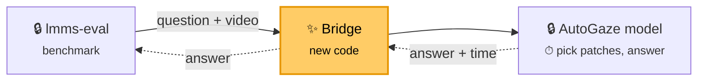

# lmms-eval bridge for AutoGaze: reproducing the codec result on EgoSchema

## The bridge

`autogaze_lmms_eval` is a bridge that lets [lmms-eval](https://github.com/EvolvingLMMs-Lab/lmms-eval), a standard independent benchmark tool, evaluate the custom models in AutoGaze without changing either codebase:



lmms-eval scores the answers (accuracy); the model's time per question gives latency. The bridge is two small programs, `client.py` (inside lmms-eval) and `server.py` (next to the model), so each side keeps its own Python environment. The launcher runs one bridge + model per method (dense, autogaze, codec), each on its own GPU.

We use it to reproduce the EgoSchema "Headline result" of `AutoGaze/Codec_Selector_Feasibility.md`, where NVILA-8B-HD-Video reads **all** image patches (dense), patches picked by a small network (autogaze), or patches picked from HEVC compression data (codec). Step 8 runs the same flow for Qwen3.5-9B and Nemotron-3-Nano-Omni-30B-A3B.

## Expected result

| 500 questions, 1 GB200/method | Accuracy (±2) | Tokens (exact) | Sec/question (varies) |
|---|--:|--:|--:|
| codec | 65.4% | 2,783 | 1.44 |
| dense | 64.0% | 24,690 | 3.54 |
| autogaze | 65.8% | 1,837 | 7.33 |

## Optional: let an AI agent run it

Skip this section to run everything by hand.

Do steps 1–5 yourself, including the step 8 env and downloads and the video download (installs, the codec-tool build and writes to `$HF_HOME` are off-limits to the agent), then hand the rest to an agent such as Claude Code. Three guardrails keep it from changing anything that would invalidate the result:

**1. Folder permissions.** Make the inputs read-only at the OS level:

```bash
chmod -R a-w AutoGaze lmms-eval autogaze_lmms_eval tools envs reference LMMS_EVAL_BRIDGE.md
```

| Folder | Agent may |
|---|---|
| `AutoGaze/`, `lmms-eval/`, `autogaze_lmms_eval/`, `tools/` | read and run scripts; never edit, rebuild, `pip install` or change git state |
| `$HF_HOME`, `$CONDA_BASE` | read only; only the launcher's download writes data |
| `runs/` | read only; only the launcher, `verify_alignment.sh` and lmms-eval write there, and each finished run is made read-only |
| `.claude/` | nothing: these are the agent's own rules |

**2. Claude Code settings.** Install the rules from `repro/claude_settings.local.json` with your paths:

```bash
mkdir -p .claude
sed -e "s#/home/scratch.thannan_wwfo/codec_reproduce#$WORK#g" -e "s#/home/thannan/scratch/codec_reproduce#$WORK#g" \
    -e "s#/home/scratch.thannan_wwfo/hf_cache#$HF_HOME#g"     -e "s#/home/thannan/scratch/hf_cache#$HF_HOME#g" \
    -e "s#/home/scratch.thannan_wwfo/miniforge-aarch64#$CONDA_BASE#g" -e "s#/home/thannan/scratch/miniforge-aarch64#$CONDA_BASE#g" \
    autogaze_lmms_eval/repro/claude_settings.local.json > .claude/settings.local.json
```

It has three layers: `permissions.deny` blocks the agent's file-edit tool on those folders, `sandbox.filesystem.denyWrite` blocks its shell commands from writing there, and `autoMode.hard_deny` lists the same rules in plain English so auto mode never approves them.

**3. Sandbox.** Start the agent from `$WORK` (so it loads `.claude/`), turn on sandboxing with `/sandbox`, and give it `autogaze_lmms_eval/repro/RUN_SESSION_PROMPT.md` as the task (swap in your paths with the same `sed`). It runs steps 6–8 (NVILA, Qwen3.5, Omni; smoke then full), stops at the first failure and never prints `HF_TOKEN`. It does not report results: it gives back only tags, commands, exit codes and the paths of the `RESULTS.md` files the launcher wrote. Its rules deny it edits anywhere in `$WORK`, `$HF_HOME`, `$CONDA_BASE` and the model_compat dirs.

## You need

- GB200 (`aarch64`) Slurm node, 4 GPUs, ~250 GB disk (~330 GB with step 8); ~1 h setup + ~1 h run
- SSH access to GitHub `thannan-ctrl/{AutoGaze,autogaze_lmms_eval}` and GitLab `gitlab-master.nvidia.com:12051/seadie/hevc_dump`
- Hugging Face token that accepted the `lmms-lab/egoschema` terms
- The kit `/home/scratch.thannan_wwfo/codec_reproduce/{tools,envs,reference}` 

## 1. Node and variables

```bash
srun --partition=<gb200 partition> --gres=gpu:4 --time=04:00:00 --pty bash
tmux
```

Paste in **every** new shell (unset variables silently fall back to Thannan's paths):

```bash
export WORK=/path/to/your/codec_reproduce CONDA_BASE=/path/to/your/miniforge-aarch64
export HF_HOME=$WORK/hf_cache SERVER_ENV=autogaze_av19 CLIENT_ENV=lmms-eval HF_TOKEN=hf_...
unset PYTHONPATH; mkdir -p $WORK && cd $WORK
[ -x $CONDA_BASE/bin/conda ] && eval "$($CONDA_BASE/bin/conda shell.bash hook)"
L=$WORK/autogaze_lmms_eval/scripts/run_egoschema_headline.sh   # launcher
T=$WORK/autogaze_lmms_eval/scripts/headline_table.py            # results table
W=$HF_HOME/egoschema/videos/001934bb-81bd-4cd8-a574-0472ef3f6678.mp4   # warm-up video
QWEN=$HF_HOME/hub/models--Qwen--Qwen3.5-9B/snapshots/c202236235762e1c871ad0ccb60c8ee5ba337b9a   # step 8 only
OMNI=$HF_HOME/hub/models--nvidia--Nemotron-3-Nano-Omni-30B-A3B-Reasoning-BF16/snapshots/e5e9932441de940c9a62185c870ea5bcd4cd24e2
uname -m   # must be aarch64
```

## 2. Conda and code

```bash
# conda (skip if $CONDA_BASE already exists)
curl -L -o /tmp/mf.sh https://github.com/conda-forge/miniforge/releases/latest/download/Miniforge3-Linux-aarch64.sh
bash /tmp/mf.sh -b -p $CONDA_BASE && eval "$($CONDA_BASE/bin/conda shell.bash hook)"

# code at the exact commits used
git clone git@github.com:thannan-ctrl/AutoGaze.git && git -C AutoGaze checkout 9899fd6829444fdd5ebc86366fd35073816ac635
git clone git@github.com:thannan-ctrl/autogaze_lmms_eval.git && git -C autogaze_lmms_eval checkout cc8a3d182a5368acdb600da18cb6327436276894
git clone https://github.com/EvolvingLMMs-Lab/lmms-eval.git && git -C lmms-eval checkout d6cc2b567db7aeacbbf1af11b6595676e784d1d3
cp -r /home/scratch.thannan_wwfo/codec_reproduce/{tools,envs,reference,LMMS_EVAL_BRIDGE.md} . && chmod -R u+w tools
```

Keep all folders side by side in `$WORK`; results go to `$WORK/runs/`.

AutoGaze `9899fd6` (branch `pareto/main`) adds `model_compat/` for step 8. Outside `model_compat/` it differs from the earlier pin `0234e8e` only in docs and figures, so steps 1–7 are unchanged.

## 3. Python environments

```bash
# server (model); needs av 19 — av 18 crashes every few hundred videos
conda create -y -n autogaze_av19 -c conda-forge python=3.12.13 && conda activate autogaze_av19
pip install -r envs/server_requirements.txt
python -c "import av, torch, transformers as t; print(av.__version__, torch.__version__, torch.cuda.is_available(), t.__version__)"
#   expect: 19.0.1 2.14.1 True 5.14.1
conda deactivate

# client (lmms-eval + bridge)
conda create -y -n lmms-eval -c conda-forge python=3.11.15 decord=0.6.0 && conda activate lmms-eval
pip install -r envs/client_requirements.txt
pip install --no-deps -e lmms-eval -e autogaze_lmms_eval
python -c "from lmms_eval.models import get_model; print(get_model('autogaze'))"
#   expect: <class 'autogaze_lmms_eval.client.AutoGaze'>
conda deactivate

# step 8 only: server for Qwen3.5 / Nemotron-Omni = the autogaze_av19 packages plus their kernels
# (a separate env, so the NVILA env above stays exactly as pinned). The two kernel packages compile
# against torch 2.14.1 for aarch64 and need nvcc on PATH (~20 min).
conda create -y -n autogaze_mc -c conda-forge python=3.12.13 && conda activate autogaze_mc
pip install -r envs/server_requirements.txt
pip install flash-linear-attention==0.5.2 fla-core==0.5.2 timm==1.0.22 einops==0.8.2 open_clip_torch==3.3.0 \
            decord==0.6.0 librosa==0.11.0 soundfile==0.13.1 scipy==1.15.3
pip install --no-build-isolation causal-conv1d==1.6.0 mamba-ssm==2.3.2.post1
python -c "from transformers.models.qwen3_5 import modeling_qwen3_5 as m; import mamba_ssm; print(m.is_fast_path_available)"
#   expect: True
conda deactivate
```

## 4. Codec tools

```bash
$CONDA_BASE/envs/autogaze_av19/bin/python -m venv .buildtools && .buildtools/bin/pip install cmake==4.4.2
PATH=$WORK/.buildtools/bin:$PATH tools/build_autogaze_native.sh
#   expect: [native] native tools ready in .../AutoGaze/native/build_aarch64
```

## 5. Model and videos

```bash
# check Hugging Face still serves the pinned versions (all must print OK)
conda activate lmms-eval
python - <<'EOF'
from huggingface_hub import HfApi
a = HfApi()
for repo, sha in [("nvidia/NVILA-8B-HD-Video", "7a5670e20da435d98b0efdc49f9a536f73985152"),
                  ("nvidia/AutoGaze", "5100fae739ec1bf3f875914fa1b703846a18943a"),
                  ("lmms-lab/egoschema", "58350524ea7eb29c47000121f4f4b65eb6b4acb9"),
                  # step 8 only
                  ("Qwen/Qwen3.5-9B", "c202236235762e1c871ad0ccb60c8ee5ba337b9a"),
                  ("nvidia/Nemotron-3-Nano-Omni-30B-A3B-Reasoning-BF16", "e5e9932441de940c9a62185c870ea5bcd4cd24e2"),
                  ("nvidia/C-RADIOv4-H", "0057b339059c0b9e1b4ba996f975410ebbfdfcc8")]:
    got = (a.dataset_info if "egoschema" in repo else a.model_info)(repo).sha
    print(repo, "OK" if got == sha else f"CHANGED to {got}: tell Thannan")
EOF
conda deactivate; conda activate autogaze_av19
hf download nvidia/NVILA-8B-HD-Video --revision 7a5670e20da435d98b0efdc49f9a536f73985152
hf download nvidia/AutoGaze --revision 5100fae739ec1bf3f875914fa1b703846a18943a
# step 8 only (~85 GB). C-RADIOv4-H is the Omni vision tower's remote code, which transformers
# looks up at its main revision, so it is downloaded without --revision (the check above pins it).
hf download Qwen/Qwen3.5-9B --revision c202236235762e1c871ad0ccb60c8ee5ba337b9a
hf download nvidia/Nemotron-3-Nano-Omni-30B-A3B-Reasoning-BF16 --revision e5e9932441de940c9a62185c870ea5bcd4cd24e2
hf download nvidia/C-RADIOv4-H
conda deactivate

# videos (~200 GB); if interrupted: rm -rf $HF_HOME/egoschema and re-run with a new name
$L --download-only egoschema_download
ls $HF_HOME/egoschema/videos | wc -l   # expect 5032
```

## 6. Test

```bash
tools/verify_alignment.sh dense autogaze codec       # expect PASS for each
R=egoschema_smoke_$(date +%Y%m%d_%H%M)
$L --limit 8 --modes "dense autogaze codec" --warmup-video $W $R   # ~10 min
cat runs/$R/RESULTS.md                              # written by the launcher
python reference/compare_tokens.py runs/$R reference
#   expect 0 mismatches; mean tokens 25,927 / 1,980 / 2,903 (dense / autogaze / codec)
```

## 7. Full run and results

```bash
R=egoschema_headline_$(date +%Y%m%d)    # every run needs a new name
$L --modes "dense autogaze codec" --warmup-video $W $R   # ~1 h; logs in runs/$R/logs/
cat runs/$R/RESULTS.md                                   # accuracy + timing, compare with Expected result
python reference/compare_tokens.py runs/$R reference     # expect 500 questions, 0 mismatches
```

Always pass `--modes`: the default adds `codec_nvdec`, which needs a newer driver.

**What every run writes.** At the end the launcher runs `headline_table.py` itself and writes `runs/$R/RESULTS.md`. That file has accuracy, the latency breakdown (preproc, selector, ViT, LLM, E2E) and an **end-to-end cross-check**. It also writes `SHA256SUMS` and makes `runs/$R/` read-only. The terminal shows only pass/fail `[status]` lines.

The cross-check compares three measurements of each question's latency:
- the repo's own `e2e_ms` (AutoGaze or model_compat timers);
- the bridge server's clock around each answer (`bridge_server_ms` in `timing_<mode>.jsonl`);
- the lmms-eval client's clock around each HTTP request (`client_timing_<mode>.jsonl`).

`Check` reads `ok` when the bridge clock agrees with the reported E2E within max(5%, 50 ms) on average. Otherwise it shows how much more the bridge measured, which is time the repo's timer leaves out. `python $T runs/$R <modes>` prints the same table again.

## 8. Other models: Qwen3.5-9B and Nemotron-3-Nano-Omni-30B-A3B

`--model qwen3_5` and `--model nemotron_omni` serve these models through AutoGaze's `model_compat` adapters, the code behind `AutoGaze/RESULTS_LATENCY_ACCURACY.md`. They are read from the `AutoGaze` checkout of step 2 and never edited.

Each request runs `model_compat.runner._one` with the pareto "best" settings: the H.264 motion-vector selector, strict L1, and EgoSchema at native resolution. lmms-eval supplies the prompt and scores the answer. Modes:

| Mode | model_compat arm |
|---|---|
| `dense` | `dense` |
| `codec_mv` | `codec` (keep 20% / 6%) |
| `codec_mv_hybrid` | `codec@first=1.0@chunk=16@rest=0.25` (recommended point) |
| `codec_mv_keep` | `codec@first=0.6@rest=0.25` |

Needs the `autogaze_mc` env (step 3), the step 8 downloads (step 5), the codec tools (step 4) and the videos.

```bash
export MC_PYTHONPATH=$CONDA_BASE/envs/autogaze_mc/lib/python3.12/site-packages   # fla from pip, not Thannan's vendored copy
R=qwen35_smoke_$(date +%Y%m%d_%H%M)
SERVER_ENV=autogaze_mc $L --model qwen3_5 --model-path $QWEN --nvf 128 --limit 8 \
    --modes "dense codec_mv codec_mv_hybrid" --warmup-video $W $R            # ~15 min
cat runs/$R/RESULTS.md

R=omni_smoke_$(date +%Y%m%d_%H%M)
SERVER_ENV=autogaze_mc $L --model nemotron_omni --model-path $OMNI --nvf 64 --limit 8 \
    --modes "dense codec_mv codec_mv_hybrid" --warmup-video $W $R
cat runs/$R/RESULTS.md
```

Drop `--limit 8` (and use a new name) for the full 500 questions.

**Reference values.** These are H100, with model_compat's own prompt and parser:
- Qwen3.5 128f: dense 72.8%, hybrid 69.4%.
- Omni 64f: dense 64.0%, hybrid 59.8%.

Expect a few points of difference here, from lmms-eval's prompt and parser, and different latency on GB200.

**More:** `AutoGaze/Codec_Selector_Feasibility.md` (original study), `autogaze_lmms_eval/EGOSCHEMA_HEADLINE.md` (launcher options), `LMMS_EVAL_BRIDGE.md` (bridge internals).
